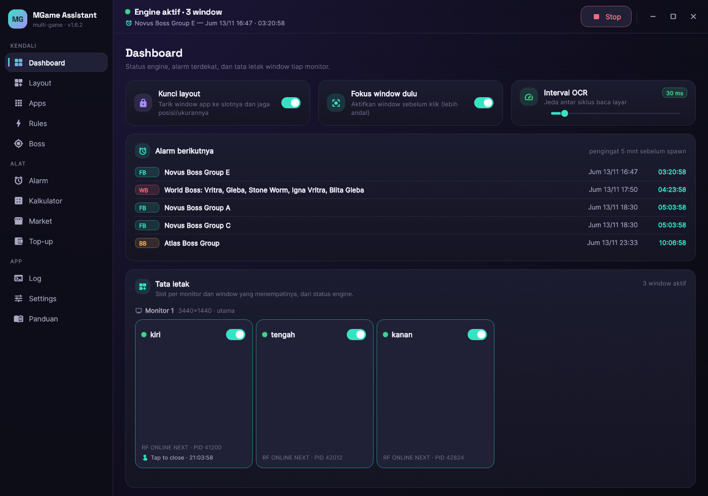
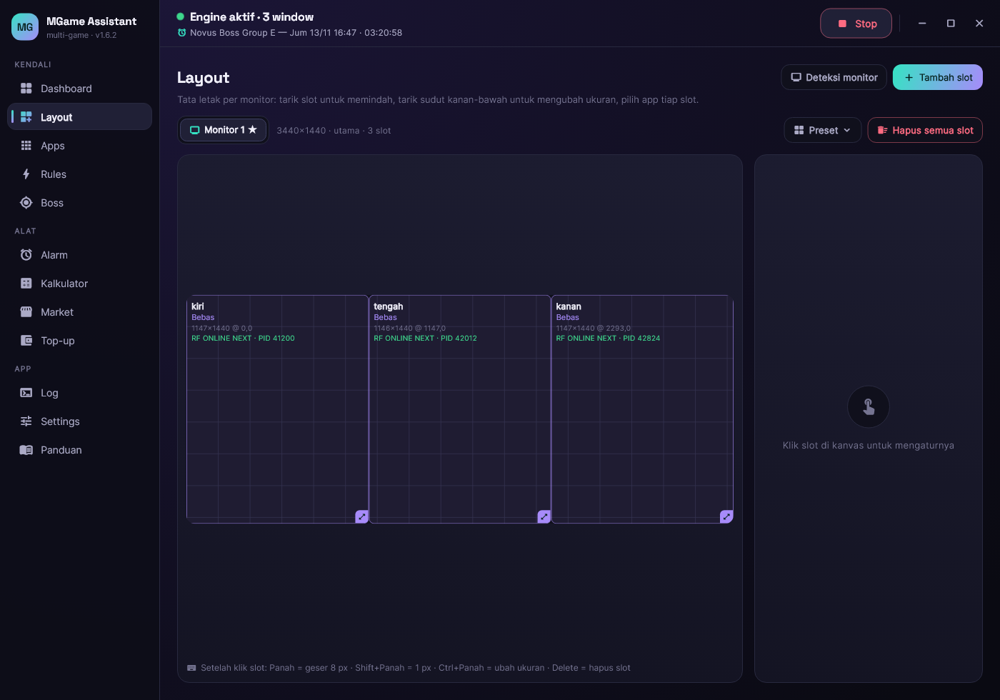
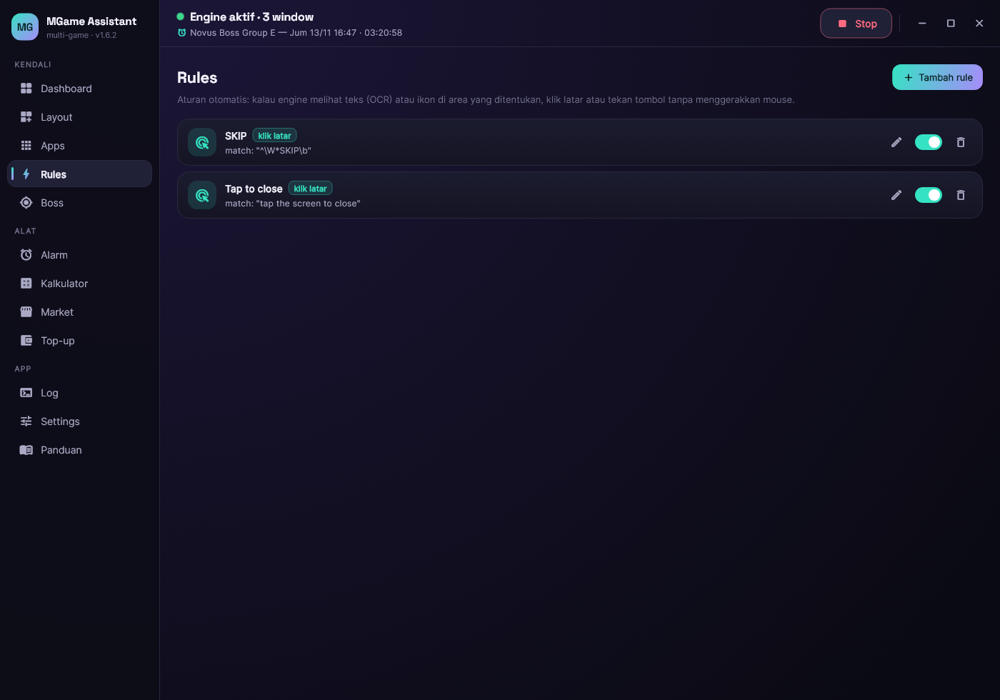
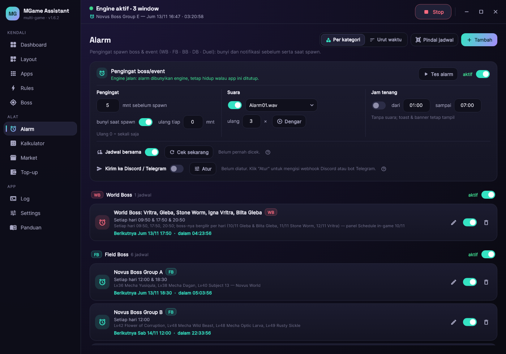
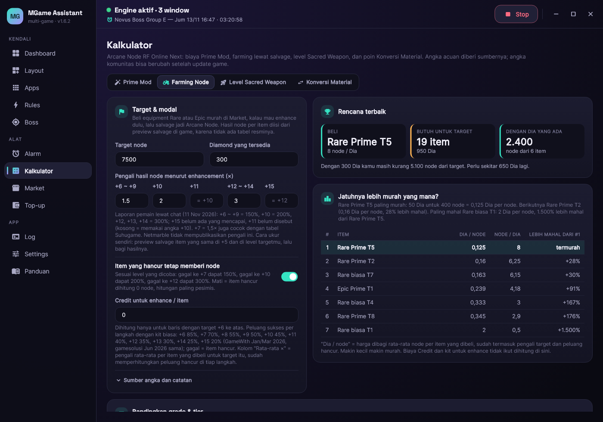
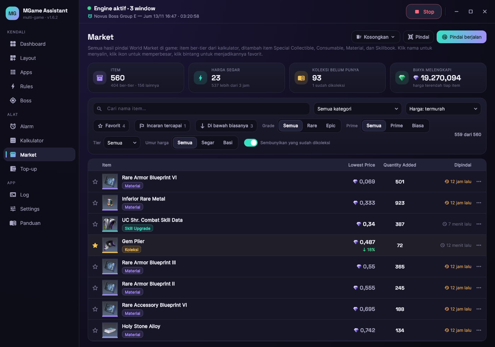
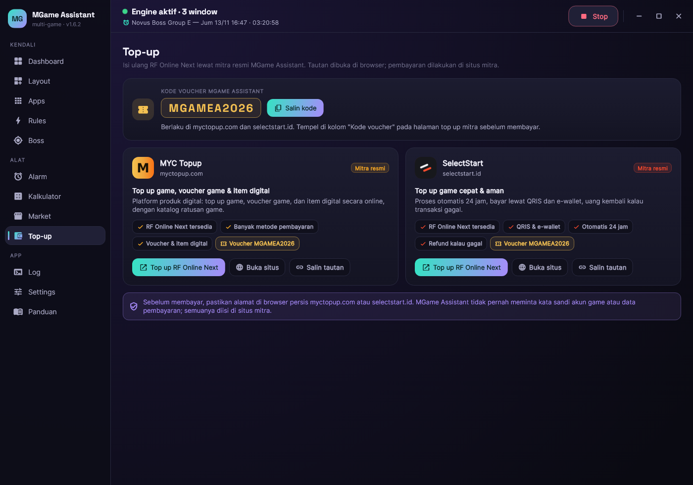
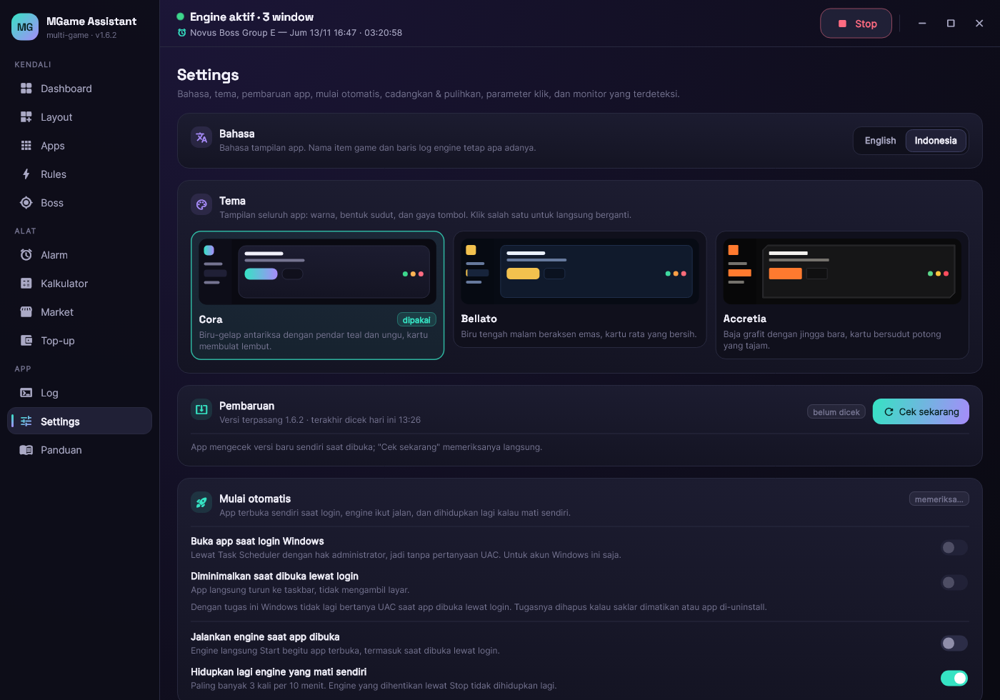
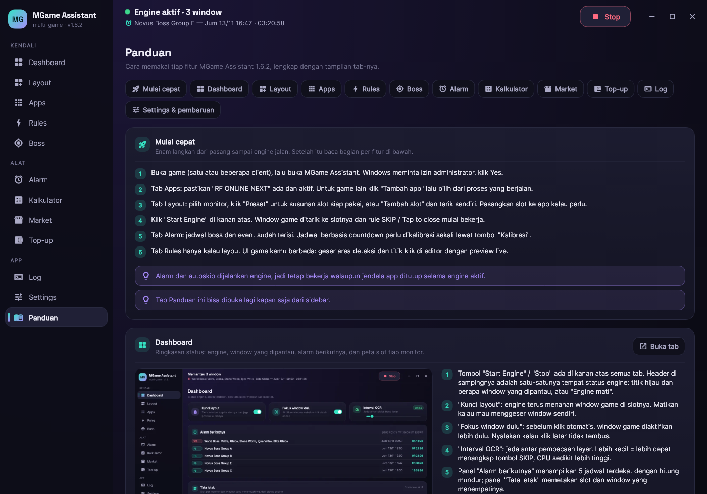

# MGame Assistant

Asisten multibox untuk **RF Online Next** di Windows: menata window game ke slot di tiap monitor,
auto-klik SKIP dan "tap to close" lewat OCR atau gambar ikon tanpa menggerakkan mouse, pengingat spawn boss
dan event, scheduler field boss, kalkulator Farming Node, tab Market (pindai World Market, favorit, harga
incaran), tautan top-up mitra beserta kode vouchernya, dan pembaruan dari dalam app. Tampilan bisa bahasa
Inggris atau Indonesia, dengan tiga tema.

**Unduh:** installer terbaru ada di halaman [Releases](../../releases/latest). Jalankan
`MGameAssistant-Setup-x.y.z.exe`; kalau muncul "Windows protected your PC", klik **More info** lalu
**Run anyway** (installer belum ditandatangani sertifikat).

Repo ini hanya menampung rilis terbaru (installer + `update.json` yang dibaca fitur pembaruan di app).

> **Penafian.** MGame Assistant adalah alat buatan pemain, tidak berafiliasi dengan dan tidak didukung oleh
> Netmarble maupun pengembang RF Online Next. Otomasi di dalam game bisa melanggar Ketentuan Layanan game dan
> berisiko sanksi pada akun. Pemakaian sepenuhnya tanggung jawab dan risiko kamu sendiri. Selengkapnya di
> bagian [Penafian](#penafian).

## Kebutuhan
- Windows 10/11 64-bit, PowerShell 5.1 (bawaan Windows).
- Hak administrator: saat app dibuka Windows menampilkan prompt UAC, klik Yes.
- OCR bawaan Windows. Kalau tab Log menampilkan error OCR, pasang paket bahasa English (United States).

## Fitur

| Tab | Fungsi |
|---|---|
| **Dashboard** | Window yang dipantau, Kunci layout, Fokus window dulu, Interval OCR, Alarm berikutnya, peta slot per monitor. Status engine dan tombol Start / Stop ada di header semua tab. |
| **Layout** | Susun slot di tiap monitor (Preset atau tarik sendiri), pasangkan slot ke app. Engine menarik window ke slot dan menjaganya. |
| **Apps** | Daftar game/app yang dikelola; tambah dari proses yang berjalan. |
| **Rules** | Autoskip: deteksi lewat teks (OCR, pola regex), lewat **gambar ikon** yang diambil dari preview, atau keduanya. Area deteksi dengan preview live, rule bisa diarahkan ke slot atau window tertentu, aksi Klik latar / Mouse 2x / Tombol. Bawaan: SKIP dan Tap to close. |
| **Boss** | Scheduler field boss (jam + grup, PID karakter, Test). Bawaan mati; mode bot, risiko ToS lebih tinggi. |
| **Alarm** | Pengingat World/Field/Base/Dungeon Boss dan Duel: bunyi, toast, banner; lead time, ulang, suara, jam tenang, kalibrasi countdown/jam spawn. Tetap berbunyi selama engine jalan walau app ditutup. Bisa dikirim ke Discord/Telegram. |
| **Kalkulator** | Empat kalkulator: Prime Mod, Farming Node (untung per jam per tier, memakai harga hasil pindai Market), Level Sacred Weapon, dan Konversi Material. |
| **Market** | Hasil pindai World Market dalam daftar seperti di game: semua kategori (gear ber-tier, Special Collectible, Consumable, Material, Skillbook), cari dan saring, favorit, **harga incaran** dengan pemberitahuan (app, Windows, Discord/Telegram), riwayat harga dan tanda "di bawah biasanya". Membaca daftar hanya memotret jendela game; gulir dan pindah tab otomatis bersifat opsional. |
| **Top-up** | Tautan ke mitra resmi MYC Topup dan SelectStart, langsung ke halaman RF Online Next, dan **kode voucher `MGAMEA2026`** yang berlaku di keduanya. |
| **Log** | Aktivitas engine: saring, hanya error, ikuti, salin. |
| **Settings** | Bahasa (Inggris / Indonesia), **tiga tema** (Cora, Bellato, Accretia), mulai otomatis saat login, **Cadangkan & pulihkan** pengaturan dan data ke satu berkas, cooldown klik, monitor, dan **Pembaruan** dari dalam app. |
| **Panduan** | Penjelasan tiap fitur beserta tampilan tab-nya; tampil otomatis saat pertama dibuka. |

## Tampilan

## Langkah pertama
1. Buka game (satu atau beberapa client), lalu buka MGame Assistant.
2. Tab Apps: pastikan "RF ONLINE NEXT" ada dan aktif.
3. Tab Layout: pilih monitor, klik Preset, sesuaikan slot.
4. Klik **Start Engine** di kanan atas.
5. Tab Alarm: kalibrasi jadwal berbasis countdown sekali lewat tombol Kalibrasi.

## Pembaruan
App mengecek `update.json` dari rilis terbaru saat dibuka. Kalau ada versi baru, banner "Versi x.y.z tersedia"
muncul; klik **Perbarui sekarang**, app mengunduh installer, mencocokkan SHA256, memasang, lalu terbuka lagi.
Pengaturan tidak berubah dan engine yang sedang jalan tidak dihentikan. Kalau versi baru membawa perubahan
engine, app menampilkan banner dan cukup klik **Mulai ulang engine**.

Hanya rilis terbaru yang disediakan di sini.

## Keamanan dan privasi
- App tidak meminta dan tidak menyimpan kata sandi akun game. Ia bekerja dari tangkapan layar jendela game
  (OCR dan pencocokan gambar) serta pesan klik / tombol Windows.
- Pengaturan dan data tersimpan di PC kamu. Yang keluar dari PC hanya: cek pembaruan dan jadwal bersama
  (keduanya diunduh dari rilis di repo ini), dan kiriman alarm ke Discord / Telegram kalau kamu sendiri mengisi
  alamatnya.
- Top-up tidak dilakukan di app: tautan dibuka di browser dan pembayaran terjadi di situs mitra.
- Installer belum ditandatangani. SHA256-nya tertulis di `update.json` pada rilis; cocokkan kalau mengunduh manual.

## Penafian
- MGame Assistant adalah alat buatan pemain. Tidak berafiliasi dengan, tidak didukung, dan tidak disetujui oleh
  Netmarble maupun pengembang RF Online Next. Nama game dan merek dagang adalah milik pemiliknya masing-masing.
- Fitur otomasi (klik otomatis, scheduler boss, gulir dan pindah tab Market) bisa melanggar Ketentuan Layanan
  game dan berisiko sanksi pada akun. Baca ketentuan game, dan pakai dengan risiko sendiri.
- App disediakan apa adanya, tanpa jaminan. Pembuat tidak bertanggung jawab atas kerugian apa pun akibat
  pemakaiannya.
- Transaksi top-up adalah urusan antara kamu dan situs mitra.

## Lisensi
Gratis diunduh dan dipakai. Kode sumber tidak dibuka di repo ini.
